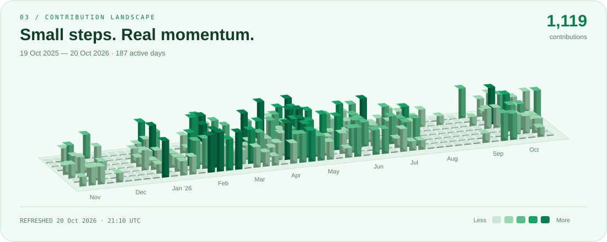

<picture>
  <source media="(max-width: 600px) and (prefers-color-scheme: dark)" srcset="assets/hero-mobile-dark.svg">
  <source media="(max-width: 600px)" srcset="assets/hero-mobile-light.svg">
  <source media="(prefers-color-scheme: dark)" srcset="assets/hero-dark.svg">
  
</picture>

  <a href="#selected-experiments">Selected work</a> &nbsp; / &nbsp;
  <a href="#engineering-toolkit">Toolkit</a> &nbsp; / &nbsp;
  <a href="#contribution-landscape">Activity</a> &nbsp; / &nbsp;
  <a href="#lets-connect">Contact</a>

I'm **Maxim**, a full-stack developer building interfaces, backends, and AI-powered tools. I like connecting the whole system: the interaction you see, the service behind it, and the data that makes it useful.

## Selected experiments

<a href="https://github.com/SomeMedic/nic-msi-expert-test">
  <picture>
    <source media="(max-width: 600px) and (prefers-color-scheme: dark)" srcset="assets/project-digital-expert-mobile-dark.svg">
    <source media="(max-width: 600px)" srcset="assets/project-digital-expert-mobile-light.svg">
    <source media="(prefers-color-scheme: dark)" srcset="assets/project-digital-expert-dark.svg">
    
  </picture>
</a>

**Local PDF RAG prototype.** Hybrid retrieval, page-linked citations, and a separate critic that checks draft answers.

`Python` `FastAPI` `LangGraph` `React` `PostgreSQL / pgvector` · [Explore source ↗](https://github.com/SomeMedic/nic-msi-expert-test)

 

<a href="https://github.com/SomeMedic/aivatar-test">
  <picture>
    <source media="(max-width: 600px) and (prefers-color-scheme: dark)" srcset="assets/project-aivatar-mobile-dark.svg">
    <source media="(max-width: 600px)" srcset="assets/project-aivatar-mobile-light.svg">
    <source media="(prefers-color-scheme: dark)" srcset="assets/project-aivatar-dark.svg">
    
  </picture>
</a>

**Streaming AI chat prototype.** Persistent conversations, cookie authentication, and Redis-backed context caching.

`TypeScript` `Next.js` `NestJS` `AI SDK` `Prisma` `Redis` · [Explore source ↗](https://github.com/SomeMedic/aivatar-test)

 

<a href="https://github.com/SomeMedic/EverythingUI">
  <picture>
    <source media="(max-width: 600px) and (prefers-color-scheme: dark)" srcset="assets/project-everything-ui-mobile-dark.svg">
    <source media="(max-width: 600px)" srcset="assets/project-everything-ui-mobile-light.svg">
    <source media="(prefers-color-scheme: dark)" srcset="assets/project-everything-ui-dark.svg">
    
  </picture>
</a>

**Expressive React components.** Animated buttons, CSS interactions, and light/dark themes with a bilingual preview interface.

`TypeScript` `React` `Next.js` `styled-components` · [Explore source ↗](https://github.com/SomeMedic/EverythingUI)

<strong>More from the lab</strong> — developer tools &amp; workflows

- [**OMX Prompts**](https://github.com/SomeMedic/omx-prompts) — Codex/OMX prompt workflows for delivery, debugging, QA, and release preparation.
- [**useProxy**](https://github.com/SomeMedic/useProxy) — a Rust development proxy with API forwarding, static files, HTTPS, and request logs.
- [**Yetti**](https://github.com/SomeMedic/Yetti) — Python backups with compression, optional encryption, restore, and integrity checks.

## Engineering toolkit

| Layer | Tools I work with |
| :--- | :--- |
| **Interfaces** | TypeScript · React · Next.js · CSS · styled-components |
| **Services & data** | NestJS · FastAPI · PostgreSQL · Prisma · Redis · Rust |
| **AI systems** | Python · LangGraph · AI SDK · pgvector · vLLM |

## Contribution landscape

<picture>
  <source media="(max-width: 600px) and (prefers-color-scheme: dark)" srcset="assets/calendar-mobile-dark.svg">
  <source media="(max-width: 600px)" srcset="assets/calendar-mobile-light.svg">
  <source media="(prefers-color-scheme: dark)" srcset="assets/calendar-dark.svg">
  
</picture>

A year of building, one day at a time. Updated daily from my GitHub contribution calendar.

## Let's connect

<picture>
  <source media="(max-width: 600px) and (prefers-color-scheme: dark)" srcset="assets/footer-mobile-dark.svg">
  <source media="(max-width: 600px)" srcset="assets/footer-mobile-light.svg">
  <source media="(prefers-color-scheme: dark)" srcset="assets/footer-dark.svg">
  
</picture>

[**Telegram ↗**](https://t.me/somemedic) &nbsp; / &nbsp; [VK ↗](https://vk.com/some.medic) &nbsp; / &nbsp; [GitHub ↗](https://github.com/SomeMedic)
